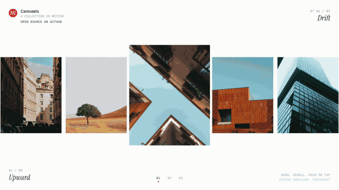

# Carousels

[](https://www.npmjs.com/package/madebymaga-carousels) [](https://github.com/magadnv/madebymaga-carousels/actions/workflows/test.yml) 

Three carousels that morph into each other: **Drift**, **Orbit** and **Fan**.
GSAP, no framework, 6.6 kB gzipped.

[Live demo](https://carousel-six-beta.vercel.app) · press 1, 2, 3 to switch



When you switch between two carousels, the old one doesn't fade out. It keeps running. Every card swaps its photo only at a spot where you can't see it, such as the edge of the screen or the moment a card in the ring stands edge-on. The new shape forms while the band is still moving.

## Install

```sh
npm i madebymaga-carousels gsap
```

## Quick start

```html
<div id="stage" style="height: 100vh"></div>
```

```js
import { createCarousel } from 'madebymaga-carousels'
import 'madebymaga-carousels/style.css'

const carousel = createCarousel('#stage', {
  layout: 'drift',
  items: [
    { src: '/img/01.jpg', title: 'Upward', credit: { name: 'Alexander Kaufmann', url: 'https://unsplash.com/…' } },
    { src: '/img/02.jpg', title: 'Timber' },
    '/img/03.jpg',
  ],
})

carousel.setLayout('fan') // morphs, returns a Promise
```

The container needs a size. The carousel fills it and runs past its edges on purpose. Photos look best in 4:5.

## The three layouts

| Layout  | Shape                                         | Hold the pointer                   |
| ------- | --------------------------------------------- | ---------------------------------- |
| `drift` | a band, the front card larger, inner parallax | spreads out, the rest turns grey   |
| `orbit` | a 3D ring                                     | the view tilts from above          |
| `fan`   | a huge arc whose centre sits below the frame  | no hold state                      |

## Options

| Option          | Default    | Description                                                                 |
| --------------- | ---------- | --------------------------------------------------------------------------- |
| `items`         | required   | `{ src, alt?, title?, credit?: { name, url?, label? } }` or a plain URL     |
| `layout`        | `'drift'`  | `'drift'`, `'orbit'`, `'fan'` or your own layout object                     |
| `repeat`        | `'auto'`   | how often items repeat; `'auto'` fills at least 12 cards                    |
| `autoplay`      | `false`    | `true` (every 2.4 s) or milliseconds                                        |
| `wheel`         | `'x'`      | `'x'` only horizontal scroll, so the page still scrolls; `'both'`; `false` |
| `keyboard`      | `true`     | arrow keys and Enter while the container has focus                          |
| `hold`          | `true`     | hold the pointer to reveal the second state                                 |
| `credits`       | `true`     | tap the front card to show its credit                                       |
| `intro`         | `true`     | entrance animation                                                          |
| `reducedMotion` | `'auto'`   | follows `prefers-reduced-motion`; `true` or `false` to force                |
| `label`         | `'Carousel'` | `aria-label` of the container                                             |

## API

```js
carousel.next()
carousel.prev()
carousel.goTo(3)                                   // the short way round
await carousel.setLayout('orbit', { items, direction: -1 })
carousel.play(3000)
carousel.pause()
carousel.destroy()                                 // leaves the container exactly as it was

carousel.index, carousel.item, carousel.items, carousel.layout, carousel.playing
```

### Events

```js
const off = carousel.on('change', ({ index, item, total, direction }) => {})
carousel.on('layoutchange', ({ layout, items, direction, duration }) => {})
carousel.on('select', ({ index, item }) => {})     // front card tapped or Enter
off()
```

## Write your own layout

Every layout places a card on the same grid. That shared grid is why any two layouts can morph into each other.

```js
import { createCarousel, P0 } from 'madebymaga-carousels'

const line = {
  name: 'line',
  unit: (S) => S.W * 1.1, // pixels of drag per card
  layout: (d, s, S, n) => ({
    ...P0,
    X: d * S.W * 1.1,
    SC: 1 - Math.min(Math.abs(d), 1) * 0.15,
    OP: 1 - Math.abs(d) / (n / 2),
    ZI: 100 - Math.round(Math.abs(d) * 10),
  }),
}

createCarousel('#stage', { items, layout: line })
```

`d` is the card's signed distance from the front card. `s` holds `pos`, `vel`, `hold` (0 to 1) and `intro` (0 to 1). `S` holds the sizes: `W`, `H`, `vw`, `vh`, `R`, `persp` and more. The full pose is typed in [`types/index.d.ts`](types/index.d.ts).

## How it works

- **One state, many inputs.** Drag, wheel, keys and autoplay write only to `target`. Every frame eases `pos` toward it, so all motion stays soft.
- **Invisible swaps.** During a morph, `visEdge()` projects the four corners of each card the way the browser does. It finds the first spot on each side where a card is outside the frame or has no area left. A card may swap its photo only while it passes that spot.
- **Front or back, computed.** The renderer checks the card's normal against the way to the camera itself, instead of trusting `backface-visibility`, so cards in the ring flip exactly when they stand edge-on.
- **Idle means idle.** At rest nothing is written to the DOM, and a carousel scrolled out of view does no work.

## Accessibility

- The container is a focusable `region` with `aria-roledescription="carousel"`.
- Changes are announced through a polite live region ("3 / 6: Timber").
- With `prefers-reduced-motion`, the intro, the velocity lean and the morph are switched off. Layouts change in place.

## Development

```sh
npm install
npm run dev      # demo on http://localhost:5720
npm test         # vitest
npm run build    # dist/carousels.js + dist/carousels.css
```

The demo in [`demo/`](demo) uses the package exactly like an app would. Its photos are not in this repo, because they belong to their photographers. Put your own into `demo/public/img/01…03/` as `01.jpg`, `02.jpg` and so on.

## License

MIT © [madebymaga](https://madebymaga.de)
